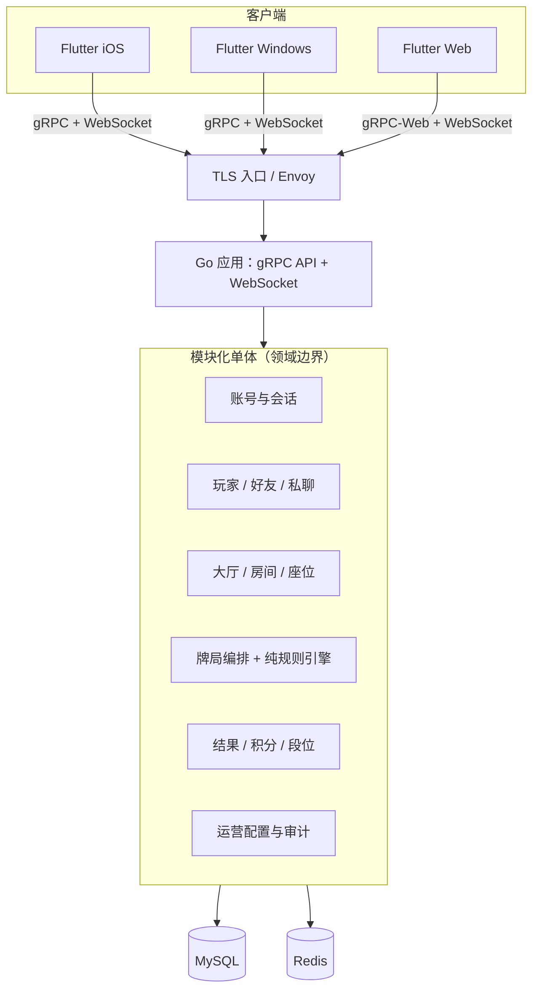

# 淮安80分技术架构设计

> 状态：架构方案 v1.0（技术栈已按产品方选择；业务与运维待确认项见第 13 节）
> 需求基线：[design.md](./design.md)；玩法权威规则：[淮安80分业务规则.md](./淮安80分业务规则.md)。
> 本文定义技术实现方案。遇到玩法冲突时，以业务规则文档为准；需求文档与业务规则之间的语义冲突需先确认，不能由实现自行猜测。

## 1. 已确认的技术决策

| 范围 | 决策 |
|---|---|
| 服务端 | Go，Linux 部署，模块化单体；先以单一应用交付，不提前拆微服务 |
| 客户端 | Flutter，共享 iOS、Windows、Web 客户端代码 |
| 客户端通信 | gRPC 命令/查询 + WebSocket 实时事件 |
| 持久化 | MySQL 作为唯一业务事实来源 |
| 临时状态 | Redis 用于在线状态、连接/房间索引、短期协调及缓存；不能作为牌局或积分的唯一存储 |
| API 定义 | Protocol Buffers；服务端使用 grpc-go |
| 积分边界 | GameSession（整场）结束时结算一次；单手 Hand 只记录升级/换庄结果 |
| 积分下限 | 允许负分，以保持胜负双方严格零和 |
| 断线处理 | 断线等待 60 秒，之后由服务端托管继续；托管动作须记录为游戏事件 |
| 首发登录 | 用户名/邮箱 + 密码；首发不包含手机号验证码登录 |
| 运行形态 | Docker Compose 部署到单台 Linux 主机；后续按负载和可用性目标扩展 |

## 2. 架构目标与边界

- 服务端对洗牌、手牌、底牌、出牌合法性、当前轮次、升级与积分结算拥有最终权威；客户端只提交意图并展示服务端状态。
- 房间之间状态隔离；同一房间的动作按序处理，不能因并发请求、重试或重连重复执行。
- 牌局状态可在进程重启后从 MySQL 快照和事件恢复；客户端可用事件序号补齐断线期间的更新。
- 按领域模块组织单体代码，以稳定的 Protobuf API 供 Flutter 各端使用；只有在有明确容量或团队边界后才拆服务。
- 运营配置、已开始牌局和审计记录可追溯；配置修改不得改变已经开始的牌局规则。

**不在本阶段承诺**：具体云厂商、目标在线人数/SLO、自动匹配系统、运营后台 UI、支付、语音、跨地域容灾。

## 3. 逻辑架构



### 3.1 模块职责

| 模块 | 职责与边界 |
|---|---|
| 账号与会话 | 注册、登录、密码/验证码验证、会话签发和撤销、账号状态。密码哈希和用户凭据不可出现在玩家 API 响应中。 |
| 玩家与社交 | 昵称/头像、好友关系、好友邀请、房间及私聊消息。私聊持久化策略需确认。 |
| 大厅与房间 | 大厅准入、房间生命周期、房主、座位、旁观者、观战许可、房间成员变化。 |
| 牌局编排 | 房间内游戏生命周期和每手状态；一个房间内的状态变更串行化；断线恢复与托管计时器。 |
| 规则引擎 | 纯 Go 领域逻辑：牌力比较、跟牌/毙牌、拖拉机、510k、抽筋、抄底、翻盘、必打级、升级、上天入地与春天判定。不得依赖网络、数据库、Redis 或客户端代码。 |
| 结果与积分 | 根据规则引擎输出生成最终结果；按幂等键原子更新积分、段位、战绩和积分流水。 |
| 配置与审计 | 结算参数、大厅门槛、段位、超时等版本化配置；配置变更留存操作者、时间、旧值、新值和生效范围。 |
| 实时推送 | WebSocket 鉴权、订阅房间、事件序号、重连补发；按用户/座位过滤私有手牌信息。 |

以上模块先在一个 Go 进程、一个部署单元内运行，通过 Go package 和依赖方向隔离，不通过模块间循环调用。数据库访问按模块仓储接口封装；不使用跨模块共享可变内存作为事实来源。

## 4. 技术组件

| 层 | 组件/约定 |
|---|---|
| 服务端 | Go、grpc-go、Protocol Buffers；规则引擎与领域服务不绑定具体传输协议 |
| 入口 | Envoy 终止 TLS、路由原生 gRPC 和 gRPC-Web、升级 WebSocket；外部不直接暴露 MySQL/Redis |
| iOS/Windows 客户端 | Flutter；Protobuf/gRPC 客户端 + WebSocket 客户端 |
| Web 客户端 | Flutter Web；通过 Envoy 的 gRPC-Web 能力访问 RPC，WebSocket 接收事件。须在选定 Flutter/Dart gRPC-Web 实现后做浏览器兼容性验证 |
| 主数据库 | MySQL 8.x/InnoDB；外键或等价约束、事务、唯一索引；所有时间存 UTC |
| 临时状态 | Redis；仅缓存、Presence、房间索引、短期租约/限流。Redis 故障时不得伪造成功的牌局动作或积分结算 |
| 数据迁移 | 版本化 SQL migration；应用启动检查 schema 版本，生产迁移作为独立发布步骤执行 |
| 配置与密钥 | 非敏感配置由环境变量/部署配置提供；密钥、数据库凭据由部署环境的 Secret 管理，不写入仓库 |
| 日志/监控 | 结构化日志、请求/游戏关联 ID、Prometheus 指标、OpenTelemetry traces；不得记录密码、Token 或完整手牌 |
| 测试 | 规则引擎表驱动单测/属性测试；MySQL 集成测试验证并发、幂等和崩溃恢复；协议兼容测试覆盖三端 |

## 5. 房间与牌局状态

### 5.1 概念模型

为避免“局/盘”混用，技术模型区分：

- **Room**：长期存在的房间，包含大厅、成员、座位和房间设置。
- **GameSession（整场）**：从初始级数开始，持续多手直至一方达到规则定义的胜利条件；保存大厅、参赛者、双方级数、庄家、配置版本及最终积分结算所需的数据。
- **Hand（单手）**：一次发牌至升级/换庄结果的过程；保存牌局阶段、当前手牌/底牌、主花色、轮次、抓分和本手结果。
- **GameEvent**：每个成功状态变更的持久化事件，按 GameSession 内递增序号排列。

本模型把业务规则里每次发牌称为 Hand，把设计文档 3.2 所述“整盘结束才结算积分”解释为 GameSession 结束；已确认整场结束时才发放一次积分，单手只推进级数/庄家状态。

### 5.2 状态机

Hand 至少支持以下服务端状态：

`WAITING → DEALING → TRUMP_SELECTION → BURYING → COUNTER_TRUMP → PLAYING → HAND_RESULT → NEXT_HAND`

GameSession 结束时转入 `SESSION_RESULT → SETTLED`。异常结束必须进入明确的 `ABORTED` 或规则规定的判负结果，不能直接删除房间/牌局状态。

规则引擎负责校验每个转移的前置条件和结果。阶段定时器由服务端管理，并作为可恢复状态持久化；客户端显示的倒计时不决定动作有效性。

### 5.3 单房间串行化和状态恢复

1. 每个房间同时只允许一个有效状态写入者；MVP 单实例以房间 actor/锁串行处理。多实例时通过带 fencing token 的房间租约确定唯一写入者，旧租约持有者的写入须被拒绝。
2. 每条动作包含 `request_id`（客户端生成的幂等 ID）和 `expected_version`。服务端验证成员权限、当前阶段、轮次、版本及动作合法性。
3. 对成功动作，在 MySQL 事务中追加事件、更新当前状态/快照和递增版本后提交，再返回成功并推送事件。事件写入失败则不确认动作成功。
4. Redis Pub/Sub 只用于低延迟通知，不能替代 MySQL 事件记录。通知丢失时，客户端用最后收到的事件序号请求补齐；若超出保留窗口则取最新可见快照。
5. 进程启动时从 MySQL 加载活动房间快照，必要时重放其后事件；重新获得房间写入租约后再接受动作。
6. 洗牌由服务端安全随机源完成；发牌结果从未授权客户端不可见。牌局审计数据需受限访问，避免日志或快照泄露牌序。

## 6. MySQL 数据模型

使用 InnoDB；主键建议 `BIGINT`（由服务端生成）或经确认的 UUID/ULID。下表列出逻辑实体，不等同于最终 DDL。

| 表 | 关键字段/约束 | 说明 |
|---|---|---|
| `users` | `id`、`phone`、`email`、`username`、`password_hash`、`status`、`created_at`；账号标识分别唯一（允许未提供的标识为 NULL） | 账号与凭据；敏感字段独立控制访问 |
| `sessions` | `id`、`user_id`、`token_hash`、`expires_at`、`revoked_at`、`device_id` | 只保存 Token 哈希/会话标识，不存明文可复用 Token |
| `player_profiles` | `user_id`、`nickname`、`avatar`、`points`、`rank`、`updated_at` | 当前积分、段位为可查询投影，流水是审计依据 |
| `friendships` | `user_id`、`friend_id`、`status`、时间戳；唯一约束 `(user_id, friend_id)` | 双向关系的存储方式由社交模块统一维护 |
| `rooms` | `id`、`hall_id`、`owner_id`、`status`、`settings_json`、`version` | 房间元数据；密码房保存强哈希，不保存明文密码 |
| `room_members` | `room_id`、`user_id`、`seat_no`、`role`、`joined_at`；房间内座位唯一 | 坐下/旁观和座位约束 |
| `game_sessions` | `id`、`room_id`、`config_version`、`status`、玩家/队伍映射、起止时间、最终结果 | 一整场的边界和不可变规则配置版本 |
| `hands` | `id`、`game_session_id`、`hand_no`、`status`、`state_version`、`snapshot`、`started_at`、`ended_at` | 单手当前状态快照；快照中手牌内容不可直接暴露给普通查询 |
| `game_events` | `game_session_id`、`seq`、`hand_id`、`event_type`、`payload`、`actor_id`、`request_id`、时间；唯一 `(game_session_id, seq)` 和幂等约束 | 可审计事件日志；敏感牌面按权限保护/加密 |
| `match_results` | `game_session_id` 唯一、胜方、级差、结束类型、大厅系数、最终结果 | 一整场最终结果，防止重复生成 |
| `point_ledger` | `id`、`game_session_id`、`user_id`、`delta`、`balance_after`、规则/配置版本；唯一 `(game_session_id, user_id)` | 积分增减唯一来源，禁止重复结算 |
| `chat_messages` | `id`、`room_id`/会话双方、`sender_id`、`body`、`created_at` | 留存期限、删除和隐私规则待确认 |
| `config_versions` | `version`、`key`、`value`、`effective_at`、`operator_id`、`created_at` | 配置历史和审计；游戏开始时记录所用版本 |
| `outbox_events` | `id`、`event_type`、`aggregate_id`、`payload`、`published_at` | 需要可靠异步通知时采用事务 Outbox，避免 DB 提交与消息投递脱节 |

**事务和索引重点**

- 积分结算在一个 MySQL 事务内完成：锁定/校验 GameSession 状态，插入唯一 `match_results`，为每名玩家插入唯一 `point_ledger`，更新 `player_profiles.points/rank`，将 GameSession 标记为 `SETTLED`。任一步失败则整体回滚；重试命中唯一键后读取原结算结果。
- `game_events` 以 `(game_session_id, seq)` 顺序读；大厅房间列表按 `(hall_id, status, updated_at)` 查；用户历史按 `(user_id, created_at)` 查；私聊按会话和时间分页查。
- `points` 使用整数；大厅系数以整数基点存储（1.0x=10000、1.5x=15000、2.0x=20000），避免浮点误差。结算取整规则需在业务规则中定义。
- 游戏事件保留期、归档/分区策略根据流量与合规要求确认后执行；不得在未确认保留要求前自动删除审计记录。

## 7. gRPC 与实时接口

所有 RPC 使用 Protobuf 定义并纳入 API 版本管理。认证信息通过 gRPC metadata 的 Bearer Token 传递；服务端从 Token 取得用户身份，不接受客户端自报 user ID 作为授权依据。

### 7.1 RPC 服务划分

| 服务 | 主要方法（接口草案） |
|---|---|
| `AuthService` | `Register`、`Login`（用户名/邮箱 + 密码）、`RefreshSession`、`Logout`、`ChangePassword` |
| `PlayerService` | `GetProfile`、`UpdateProfile`、`GetStatistics`、`ListRecentResults` |
| `LobbyService` | `ListHalls`、`ListRooms`、`CreateRoom`、`JoinRoom`、`LeaveRoom`、`JoinByCode` |
| `RoomService` | `GetRoom`、`SitDown`、`ChangeSeat`、`StandUp`、`InviteFriend`、`SetSpectatorView`、`SetHandVisibility`、`StartGame` |
| `GameService` | `SubmitAction`、`GetGameSnapshot`、`ListEventsAfter`、`RequestReconnect` |
| `FriendService` | `SearchPlayers`、`SendRequest`、`RespondRequest`、`ListFriends`、`RemoveFriend`、`SendRoomInvite` |
| `ChatService` | `SendRoomMessage`、`ListRoomMessages`、`SendPrivateMessage`、`ListPrivateMessages` |
| `ConfigService` | 客户端可读公开配置；管理配置写接口只对授权运营身份开放，且必须审计 |

示例动作类型包括：定主/反主/回头望、扣底、跟牌/甩牌、确认托管动作。`SubmitAction` 的请求统一包含 `game_session_id`、`hand_id`、`request_id`、`expected_version` 和类型化动作载荷；服务端返回接受/拒绝结果及新版本。错误使用标准 gRPC 状态码并附稳定的业务错误码，例如 `UNAUTHENTICATED`、`PERMISSION_DENIED`、`FAILED_PRECONDITION`（阶段/版本不符）、`ALREADY_EXISTS`（重复创建）和 `RESOURCE_EXHAUSTED`（限流）。

### 7.2 WebSocket 事件通道

- 认证后订阅指定房间和 GameSession；服务端每个事件发送 `event_id`、`seq`、`type`、`game_session_id`、`hand_id`、`state_version`、`payload`。
- 客户端重连带 `last_seen_seq`；服务端从 MySQL 补发可见事件，随后继续推实时事件。
- 服务端按观众身份、座位、手牌展示设置做字段级过滤；绝不把完整状态广播给房间后再依赖客户端隐藏。
- WebSocket 消息只作通知/增量展示；权威动作仍走 `SubmitAction`，客户端重发必须使用相同 `request_id`。
- Web 端通过 Envoy gRPC-Web 访问 RPC；iOS/Windows 使用原生 gRPC。WebSocket 供全部端共用。Flutter Web 所用 gRPC-Web 插件和 Envoy 配置在技术验证中锁定。

## 8. 服务配置

配置按来源分为部署配置、密钥和运营配置：

1. **部署配置**：监听地址、MySQL/Redis 连接串、日志级别、连接池、超时、CORS/允许源、外部 URL；通过环境变量或部署配置注入。
2. **密钥**：Token 签名密钥、数据库密码、TLS 私钥等由 Secret 管理，不进入 Git、镜像、日志或客户端包。首发账号密码登录不需要短信服务密钥。
3. **运营配置**：大厅准入积分、结算档位/系数、段位区间、断线等待时间、房间限制等版本化存储于 MySQL；管理写接口需权限检查和审计。
4. 新 GameSession 开始时绑定 `config_version` 并复制实际生效参数；进行中的 GameSession 不因后台修改而改变。
5. 配置加载时验证类型、上下限、互斥项和跨字段约束；无效配置拒绝发布并明确报错，不静默回退到“看似成功”的默认值。
6. 本地开发可使用非敏感示例配置；开发/测试/生产凭据分别管理。

建议的运营配置键：`scoring.tiers`、`scoring.hall_multiplier_bp`、`rank.thresholds`、`hall.entry_thresholds`、`game.disconnect_grace_seconds`、`room.max_spectators`、`chat.retention_days`。允许负分是已确认规则，不作为可随意切换的运营开关。配置项需与产品批准后的规则一致。

## 9. 安全、权限与隐私

- 全链路 TLS；外部 gRPC/WebSocket 入口做身份验证、请求大小限制、速率限制和超时控制。
- 首发仅提供用户名/邮箱 + 密码；密码使用 Argon2id 等专用密码哈希方案。登录错误不得泄露账号是否存在。找回密码/短信验证码不纳入首发接口，恢复渠道需另行确认。
- Token 只通过 TLS 传输；服务端会话可吊销。推荐短期 Access Token + 可撤销 Refresh Session；现有需求“Access Token 默认 7 天”需产品确认后确定最终期限。
- 每个房间操作校验用户是否为房间成员以及角色；每个游戏动作再次校验座位和当前阶段。观战者永远不能调用坐下玩家动作。
- 手牌、底牌、暗扣定主和暗反牌只发送给有权知道的主体；观战开牌规则以玩家授权和房间策略共同判定。
- 防止重复动作、暴力登录、房间号枚举、私聊越权、跨房间订阅和配置未授权修改。
- 审计日志记录账号状态修改、配置发布、强制结算等管理动作；日志不记明文凭据、Token、短信验证码或未授权牌面。

## 10. Linux 部署与扩展

### 10.1 MVP 部署

- 通过 Docker Compose 在单台 Linux 主机运行 Go 应用、Envoy、MySQL 和 Redis；MySQL/Redis 使用独立持久化卷，不与应用容器共享可变本地文件。
- MVP 为单应用实例、单 MySQL 主库、Redis 单实例；启用定期备份并验证恢复。单机/单实例不是高可用承诺。
- 镜像无状态；启动时执行健康检查和数据库 schema 检查。数据库 migration 独立执行，避免多副本同时迁移。
- 网络仅入口暴露 HTTPS/gRPC 和 WebSocket；MySQL/Redis 只允许应用网络访问。

### 10.2 扩容路径

- 先扩展无状态 API；WebSocket 连接按实例路由，实例间通过 Redis 通知或后续消息总线传递房间事件。
- 牌局写入者按房间分配租约并使用 fencing token；持久化状态仍在 MySQL。达到明确吞吐瓶颈后，才考虑独立 Game Worker 或消息总线。
- MySQL 优先读写容量评估、索引和慢查询治理，再考虑只读副本、分片；积分写入始终路由主库。
- Redis 不承担持久化牌局；Redis 故障恢复后从 MySQL 重建房间索引和在线状态。
- 生产环境是否从 Docker Compose 升级到 Kubernetes 或云托管容器平台，取决于目标可用性、运维能力和预算。

## 11. 可观测性与质量门槛

至少提供以下指标与告警：活跃连接/房间/牌局数、动作处理时延和拒绝原因、房间事件落库延迟、游戏恢复次数、MySQL 连接池/事务失败/慢查询、Redis 超时、结算重试与幂等冲突、WebSocket 重连率。

请求日志和 trace 使用 `request_id`、`room_id`、`game_session_id` 关联；用户标识应脱敏。健康检查区分进程存活与依赖就绪，依赖故障不得报告为完整就绪。

发布前最低验证：

- 规则表覆盖业务规则文档中的全部正常、边界、特殊结算场景，重点包括 2/J/A 必打级、75/80 分界、510k/抽筋/抄底/翻盘/春天。
- 并发相同 `request_id` 只产生一次状态变更；不同房间同时操作互不干扰。
- 在数据库提交前后模拟进程退出，验证状态恢复和积分不会重复结算。
- 断网重连后按序恢复当前玩家可见的状态；验证旁观者、开牌/关牌、队友及对手的字段过滤。
- iOS、Windows、Web 分别验证 gRPC/gRPC-Web 登录、WebSocket 断线重连、证书和版本兼容。

## 12. 建议的 Go 项目布局

```text
cmd/
  server/
internal/
  auth/
  player/
  social/
  lobby/
  room/
  game/
    engine/       # 纯规则逻辑
    coordinator/  # 房间串行化、持久化、恢复
  settlement/
  config/
  transport/
    grpc/
    websocket/
  persistence/
    mysql/
    redis/
api/
  proto/
migrations/
```

依赖方向建议为 `transport → application/domain → repository interfaces`，MySQL/Redis 适配器实现仓储接口。`game/engine` 保持纯逻辑、确定性输入输出并可独立测试；禁止在规则包内直接访问存储或网络。

## 13. 已确认默认决策与上线门槛

T01 已确认采用下列默认方案。具体配置值和技术兼容性按表中门槛在相关任务验收时落实；不得因此改变默认权限边界。

| # | 已确认决策 | 实施与上线门槛 | 影响 |
|---|---|---|---|
| 1 | 允许同一账号多端共存；Access Token 沿用需求默认 7 天并支持滑动续期，Refresh Session 可撤销 | 每个设备/会话独立管理；退出、改密、封禁或注销时立即撤销相关会话 | 会话表、会话撤销和设备管理 |
| 2 | 聊天采用可配置留存期；建立举报/审计策略后再开放私聊 | 私聊上线前必须配置留存期限、删除规则及举报处理流程；房间聊天同样遵循配置的留存策略 | 存储成本、隐私与运营流程 |
| 3 | 观战默认不展示牌面；仅在玩家明确授权且房间规则允许时展示 | 服务端按观战者权限过滤每条 WebSocket 状态投影；未授权牌面始终不可见 | WebSocket 权限投影及作弊风险 |
| 4 | MVP 使用单台 Linux 主机上的 Docker Compose 部署 | 生产发布前明确在线人数、备份频率和 RPO/RTO；达到目标或容量瓶颈后再评估多实例/多可用区 | 部署拓扑、MySQL/Redis 高可用、预算 |
| 5 | Web 优先验证 Flutter/Dart gRPC-Web 插件并在技术验证中确定支持的浏览器 | 若插件无法满足验证要求，Web RPC 改用 HTTP/JSON 网关；WebSocket 保持不变 | Web 客户端 API 生成、Envoy 配置和兼容测试 |

托管策略的细节（例如超时后自动选择何种合法动作）应作为规则引擎的独立、可测策略实现；所有托管动作都标注服务端身份和原因，写入事件日志，不得冒充玩家主动操作。

## 14. GitHub Actions 构建产物

- master 分支中的 `server/**` 变更触发 Linux/amd64 服务端验证及 Docker 镜像归档构建；`client/**` 变更触发 Windows 客户端 MSIX 构建。暂不提供 iOS 打包 Action。
- 初始工作流约定服务端入口为 `server/cmd/server`、镜像定义为 `server/Dockerfile`；Flutter 工程位于 `client/`，并需配置 `msix` 开发依赖及 `msix_config`。工作流构建产物上传到对应 Actions run，不自动部署、发布或推送镜像仓库。
- Windows 产物为 MSIX，使用开发签名配置；自签名 MSIX 的安装需要接收方信任相应证书。正式分发前需配置经确认的签名证书或商店发布流程。
- 仓库当前只有架构/需求文档，没有上述源码或构建配置。因此工作流是待应用骨架落地后启用的构建约定；不能在缺少源码和签名材料时声称已生成可安装产物。
