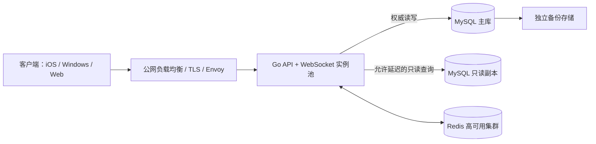

# 服务器硬件配置建议

本文按《功能需求》和《技术架构设计》给出容量规划的起始值，用于预算和初期选型，不是性能承诺。仓库目前没有线上流量数据或压测结果；服务端传输层、Redis 适配器和应用装配也尚未完整实现。因此，正式采购或发布前必须以目标版本进行并发、长连接、数据库写入和故障恢复压测，并依据监控结果调整。

## 估算口径

- “并发人数”指同时在线并保持连接的玩家数，包含坐下玩家和旁观者；每房间最多 4 名坐下玩家，但旁观者会增加长连接和事件推送负载。
- 假定主要负载是大厅/房间查询、低频游戏动作、WebSocket 状态推送和少量好友操作；不包含语音/视频、图片代理、大规模聊天、跨地域容灾或运营分析。
- 活跃牌局比例、每房间旁观人数和消息频率尚无实测值；上线前应为旁观人数设置运营上限，并压测典型与峰值场景。
- 带宽是建议的公网出口起始规格，须同时检查云厂商的入向、出向、峰值和计费定义。为峰值和协议开销预留至少约 2 倍余量。
- CPU、内存和磁盘是每台主机的建议规格。数据库磁盘按 SSD/NVMe、数据与索引以及短期增长预留估算；备份必须放在独立于数据库主机/卷的位置。
- 以下配置以 Linux、Docker 部署为前提；表中的规格是起点，不替代压测、容量监控或服务等级目标（SLO）的确认。

## 并发规模配置

| 同时在线人数 | 公网出口带宽建议 | Go 应用 / Envoy | MySQL 持久化数据库 | Redis 临时状态 | 主机划分与高可用 |
|---:|---|---|---|---|---|
| 20 | 10 Mbps | 1 台，4 vCPU、8 GB RAM | 与应用同机；数据卷至少 100 GB SSD/NVMe | 与应用同机；预留 1–2 GB | 1 台 Linux 主机运行 Compose。适合开发、试运行或低可用性要求；主机故障会导致全站中断。 |
| 200 | 20 Mbps | 1 台，8 vCPU、16 GB RAM | 与应用同机；数据卷至少 200 GB SSD/NVMe | 与应用同机；预留 2–4 GB | 初期可沿用单机 Compose，数据库和 Redis 使用独立容器及卷。若需要应用故障切换，改为至少 2 台应用主机并将 MySQL/Redis 外置或托管。 |
| 2,000 | 100 Mbps | 至少 3 台应用主机，每台 8 vCPU、16 GB RAM；前置负载均衡 / Envoy | 独立主库，16 vCPU、64 GB RAM、至少 1 TB NVMe；按只读负载增加 1 台只读副本（建议 8 vCPU、32 GB、1 TB NVMe） | 独立高可用部署，建议 3 个节点，每节点 2 vCPU、8 GB RAM；或使用托管高可用服务 | 应用、数据库和 Redis 分主机部署。跨故障域部署入口和应用；主库仍是唯一写入端，副本只承担允许延迟的读请求。 |
| 20,000 | 1 Gbps 起，建议按峰值评估 2 Gbps | 初始预留 8–12 台应用主机，每台 16 vCPU、32 GB RAM；负载均衡 / Envoy 多实例 | 独立主库，32 vCPU、128 GB RAM、至少 2 TB NVMe；初始配置 2 台只读副本，每台 16 vCPU、64 GB RAM、至少 2 TB NVMe | 独立高可用集群或托管服务，建议 3 个节点，每节点 8 vCPU、32 GB RAM；按实际键空间和峰值连接数扩容 | 多台应用、入口、Redis 和数据库主机，跨可用区部署；配置数据库故障切换、异地/独立备份和恢复演练。此级别必须先用目标负载压测验证，不能仅按在线人数直接采购。 |

磁盘容量是初始运行盘建议，不是历史数据无限增长的上限。实际数据保留时间、对局事件量、审计需求和备份保留周期确定后，应单独计算数据库容量与备份存储，并为扩容预留空间。

## 数据库和多主机建议

1. **MySQL 是持久化事实来源。** 用户、好友、对局快照与事件、结算结果和积分流水都应持久化到 MySQL。对局状态变更和事件记录、整场积分结算须保持事务原子性；多实例扩展不能绕开这些一致性要求。
2. **Redis 只保存可重建的临时状态。** 用于在线状态、连接/房间索引、短期协调和缓存。Redis 故障后应能从 MySQL 恢复必要状态；不能把牌局状态或积分只存入 Redis。即使启用 Redis 持久化，也不能代替 MySQL 和备份。
3. **读写分离按负载引入，而非默认配置。** 20 和 200 人阶段通常先使用单 MySQL 主库，做好连接池、索引和慢查询治理。达到读负载瓶颈后再增加异步只读副本，将允许短暂延迟的资料/历史等查询路由到副本；游戏动作、积分结算、权威状态恢复及需要强一致的读取仍走主库。监控复制延迟，不能让副本延迟破坏游戏状态或展示正确性。
4. **多应用实例需要房间写入协调。** WebSocket 连接由负载均衡器分配到应用实例；跨实例事件通知可经 Redis 或后续消息总线。每个房间仍须有唯一有效写入者（租约与 fencing token），不能依赖单进程内存锁来保证多主机正确性。
5. **备份独立于主机和数据卷。** 定期执行 MySQL 全量/增量或时间点恢复所需备份，并定期演练恢复；备份保留、RPO/RTO 和跨可用区/地域策略应在生产上线前确认。单机或单实例不是高可用方案。

## 参考拓扑

小规模可采用架构文档中已确认的单机 Compose 形态：入口、Go 应用、MySQL 和 Redis 在一台 Linux 主机运行，数据库数据卷独立，备份写入外部存储。达到需要高可用或约 2,000 人的规模后，可按下图拆分主机；20,000 人规模应增加冗余并跨可用区部署。

此拓扑中的只读副本是可选扩容项；小规模可省略。WebSocket 连接路由、Redis 高可用、MySQL 主库故障切换及读写路由均需在实际部署和压测中验证。

## 上线前验证

- 使用目标客户端协议和房间动作模型，分别验证目标在线连接数、活跃牌局数及峰值流量；测量 CPU、内存、带宽、连接数、动作延迟与拒绝率。
- 验证 WebSocket 重连、事件补发、房间间并发、同房间串行化和应用实例故障后的恢复。
- 验证 MySQL 慢查询、事务冲突、连接池耗尽、复制延迟和主库故障切换；确认读副本没有承接要求强一致的请求。
- 验证 Redis 故障时不会错误确认牌局动作或积分结算，并可从 MySQL 重建必要的临时索引。
- 记录实际峰值并留出容量余量；只有压测和运行数据支持时，才将本表配置作为正式生产规格。
